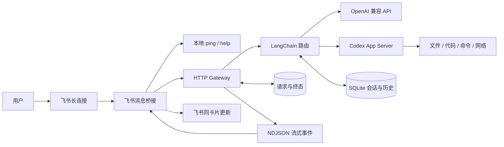

# IM Agent Gateway

**把飞书对话变成 AI 工作流入口，连接模型问答与本机 Codex 任务执行。**

面向 AI 流程搭建与应用开发的本地 Demo。用户在飞书中提出问题或发起任务，系统完成消息接入、模型路由、上下文管理和流式反馈；需要处理本机资料、编写脚本或生成文件时，由 Codex 执行并返回结果。

> 仅供演示使用。当前运行方式为个人电脑 + 个人飞书机器人。

## 解决什么问题

以跨境电商运营协作为例，日常工作既包含翻译、文案整理等轻量问答，也包含本地报表分析、批量文件处理和脚本开发。项目将这些任务放到同一个 IM 入口，同时把平台收发、模型决策与任务执行分开，便于后续扩展新的消息渠道。

| 使用场景 | 输入 | 处理过程 | 输出 |
| --- | --- | --- | --- |
| 运营日常问答 | 翻译、改写、内容归纳 | API 模型生成 | 飞书流式回复 |
| 本地资料处理 | 文件位置与分析要求 | Codex 读取资料、执行脚本、核验结果 | 分析结论与本机产物 |
| 开发与流程自动化 | 脚本需求、报错或流程目标 | Codex 修改代码、运行命令、验证结果 | 实际执行结果及说明 |
| 连续协作 | “继续”“换个模型再分析”等追问 | 恢复会话并补充最近对话 | 有上下文的后续回答 |

这些是本项目支持的任务形式，不代表已经接入企业订单系统或真实业务数据。

## 核心能力

- **统一 Gateway**：提供标准消息协议和流式事件接口，飞书桥接独立于模型执行。网关启动不依赖飞书 SDK 或凭据。
- **三种模型路由**：支持 API、Codex 和 auto；可以在对话中选择通道及模型。auto 对独立寒暄做本地快速判断，其余问题结合上下文分类。
- **本机 Agent 执行**：Codex 支持文件读写、脚本运行、命令执行、网络访问和网页搜索，使用本机已登录的 Codex 服务。
- **真实流式反馈**：正文增量通过网关传到桥接，更新同一张飞书卡片；完成与失败有明确状态。
- **连续会话**：持久化模型选择、Codex 线程映射和最近 12 轮完整对话；按平台、账号、会话与用户隔离。
- **可验证的工程行为**：请求去重、终态回放、本地自检、独立命令线程池、平滑停止及全量回归测试。

## 架构



| 层次 | 职责 | 技术 |
| --- | --- | --- |
| 消息桥接 | 事件解析、群聊响应规则、本地命令、消息发送 | 飞书 SDK、发送接口注入 |
| Gateway | 输入校验、认证、请求去重、结果回放、流式输出 | Python HTTP Server、Pydantic、SQLite |
| AI 工作流 | 模型选择、难度判断、上下文组装、工具调用 | LangChain Core、LangChain OpenAI |
| 执行后端 | 通用问答、本机任务执行 | OpenAI 兼容 API、Codex App Server |

Gateway 使用本机 HTTP；Codex 使用 WebSocket JSON-RPC 的 App Server 协议。模型生成事件通过 NDJSON 返回桥接，平台发送逻辑不会进入网关。

## 关键设计

### 让自检独立于重任务

`/ping` 和 `/help` 在桥接本地执行，并使用独立线程池。即使网关不可用或远程任务占满工作线程，仍可检查桥接是否在线。模型配置命令由网关维护，避免两套状态。

### 在延迟与判断质量之间取舍

固定通道直接回答。auto 对“你好”“谢谢”等完整匹配的独立寒暄跳过分类调用；“继续”“好的”和含具体任务的输入保留上下文分类。简单问题走 API，复杂问题走 Codex，回复附带实际通道与模型。服务失败会明确报错，不静默切换后端。

需要本机文件或命令工具的任务建议直接使用 `/use_model codex`：当前 auto 判断的是难度，尚未实现独立的工具能力路由。

### 区分生成完成与消息送达

Gateway 保存请求终态，同一消息重连可获取结果而不再次生成。桥接负责将结果送达飞书；平滑停止会等待正在执行和发送的任务结束。请求去重并不等于 IM 投递“恰好一次”，当前还没有跨崩溃自动补发队列。

### 让上下文跟随用户任务

同一用户会话串行生成。API 与 Codex 共用最近 12 轮完整记录，Codex 继续恢复已有线程。切换后端不清空业务上下文，不同用户与会话不会共享记录。

## 快速运行

环境：Windows、Python 3.12、本机已安装并登录 Codex、具有机器人能力的飞书自建应用。

```powershell
python -m pip install -r requirements.txt
Copy-Item .env.example .env
```

在 `.env` 填写飞书应用 ID 和密钥。API 服务默认使用 AGICTO，密钥读取环境变量 `AGI_KEY`，也兼容已有的 `LLM_API_KEY`。

| 配置项 | 默认值或用途 |
| --- | --- |
| `FEISHU_APP_ID` / `FEISHU_APP_SECRET` | 飞书自建应用凭据 |
| `REPLY_BACKEND` | `codex`；也可选择 `api` 或 `auto` |
| `LLM_BASE_URL` | `https://api.agicto.cn/v1/` |
| `LLM_MODEL` | `gemini-3.8-flash` |
| `CODEX_MODEL` | `gpt-6.1-sol` |
| `CODEX_REASONING_EFFORT` | `medium` |
| `CODEX_WORKSPACE` | 默认项目目录，可指定其他本机工作目录 |
| `CODEX_TIMEOUT_SECONDS` | 单次 Codex 请求超时，默认 180 秒 |

依次在三个终端启动：

```powershell
# 1. Codex 执行服务
powershell -NoProfile -ExecutionPolicy Bypass -File start-codex.ps1

# 2. 统一网关
python gateway_server.py

# 3. 飞书桥接
python feishu_bot.py
```

启动脚本默认使用本机 `7897` 代理端口，可用 `-Proxy` 参数调整；代理仅作用于该 Codex 进程。Gateway 默认监听 `http://127.0.0.1:8787`，Codex App Server 默认监听 `ws://127.0.0.1:4500`。Gateway 令牌首次启动时自动生成，配置、令牌、日志与会话数据均被 Git 忽略。

飞书配置：开启机器人能力，使用长连接订阅 `im.message.receive_v1`；授予私聊消息读取、消息发送及更新机器人卡片所需权限，发布应用。需要群聊时增加群聊 @ 消息读取权限，默认只响应 @ 机器人的消息。

更新代码或停止服务时，先桥接、后网关，等待已有任务结束：

```powershell
powershell -NoProfile -ExecutionPolicy Bypass -File stop-bot.ps1
powershell -NoProfile -ExecutionPolicy Bypass -File stop-gateway.ps1
```

## 体验流程

1. **检查入口**：发送 `/ping`，确认桥接在线；发送 `/help` 查看指令。
2. **观察路由**：发送 `/use_model auto`，先问“你好”，再提出一个多约束分析问题，观察回复中的通道和判断依据。
3. **执行任务**：发送 `/use_model codex`，要求“在当前项目的演示目录生成 12 条虚构订单数据，按市场汇总销售额，运行脚本核对结果并生成报告”。产物保存在本机，回复返回执行结果。
4. **验证记忆**：追问“把刚才的报告改为按销量排序”，检查是否沿用任务上下文并实际更新文件。
5. **观察过程**：查看同一张卡片的增量更新和最终状态，而不是等待整段回答一次性出现。

演示使用虚构数据，不将其作为真实经营结论。具体耗时受所选模型、任务规模和网络影响。

## 常用指令

| 指令 | 作用 |
| --- | --- |
| `/ping`、`/help` | 本地自检、查看功能 |
| `/use_model api` | 固定走 API 问答 |
| `/use_model codex` | 固定走 Codex，支持本机任务执行 |
| `/use_model auto` | 自动选择回答后端 |
| `/model` | 查看当前模式及模型 |
| `/model <模型ID>` | 修改当前固定后端的模型 |
| `/model api <模型ID>` | 设置 API 模型 |
| `/model codex <模型ID>` | 设置支持 medium 的 Codex 模型 |
| `/model list api`、`/model list codex` | 查看模型目录，可追加关键词筛选 |

模型选择按当前用户会话保存，模型 ID 必须通过对应目录校验。目录可见与实际调用可用是两个不同状态。

## 测试与验证

```powershell
python -m pytest tests -q
```

回归覆盖模型路由、上下文隔离、流式中断、请求去重、终态回放、并发串行化、网关鉴权、独立本地命令、禁止飞书 SDK 导入时的网关启动及平滑停止。自动化测试模拟飞书发送，不向真实聊天发送测试消息。

最近一次本地全量回归 **83 项通过**。真实 Codex 联调另行验证了文件读写、创建并运行 Python 脚本、删除测试文件及 HTTPS 请求返回 200。

功能以 spec 管理，验收、关联测试和最终结果记录在状态索引中。真实模型联调与单元测试分开记录，避免将模拟通过当作上游服务可用。

## 当前边界与扩展方向

- 已实现飞书桥接和通用网关客户端；企微适配尚未实现，后续可复用统一消息协议与模型工作流。
- Codex 在个人本机以完整执行权限运行：文件、命令和网络能力已开放。本机已配置的工具由 App Server 提供；飞书桥接尚未复刻桌面界面、插件授权窗口及交互表单，文件产物暂不自动上传飞书。
- 下一步可扩展工具能力路由、持久化投递队列和任务状态查询，再接入新的 IM 渠道。
